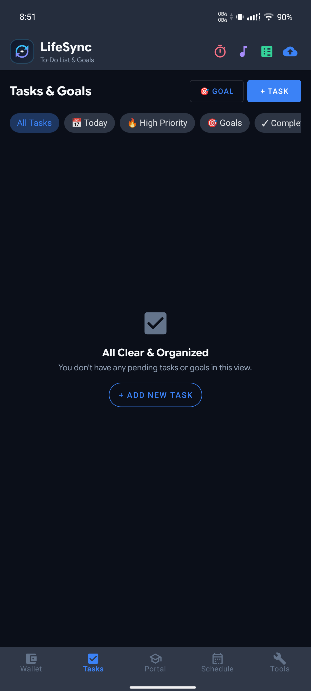
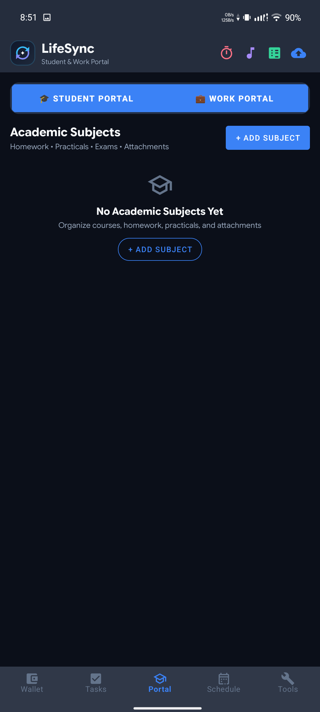
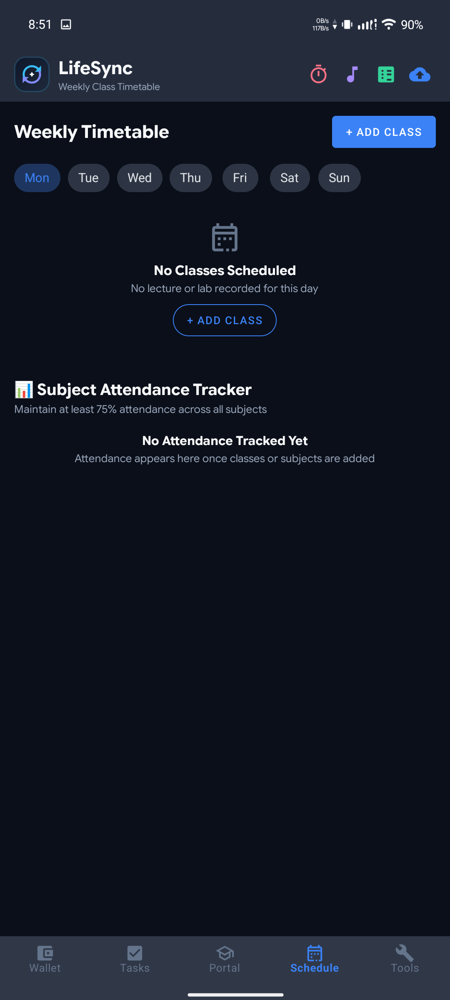
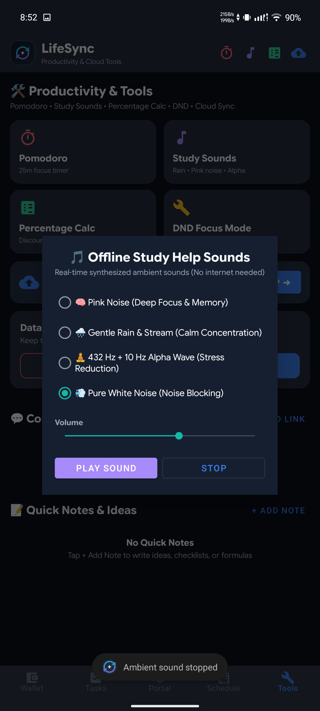
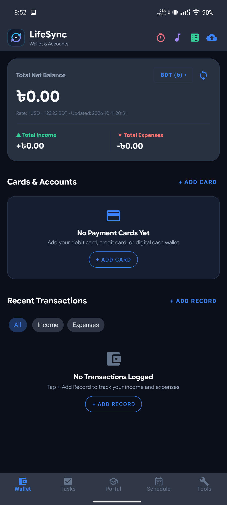
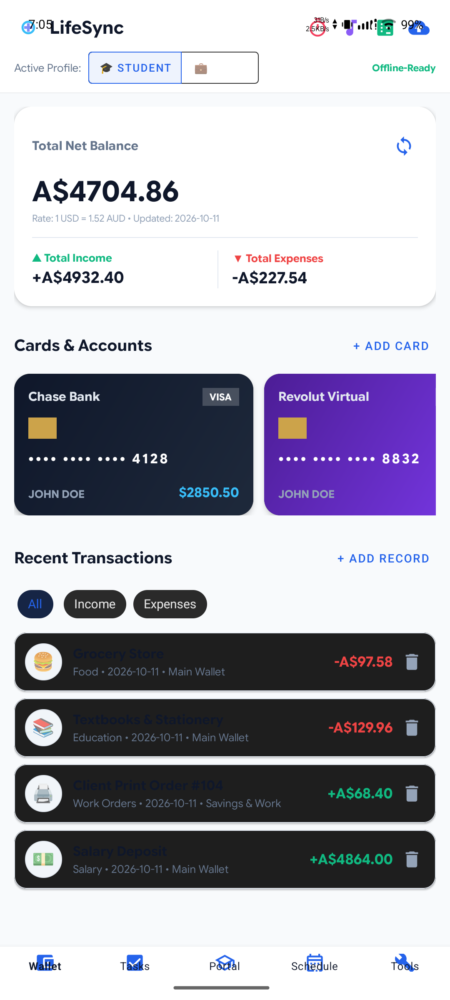

# DuoRhythm
### The Architectural Fusion of Personal Finance & Academic Engineering

DuoRhythm is an offline-first, privacy-focused productivity engine designed to eliminate the friction between financial discipline and academic performance. Built strictly with modern Android architecture and wrapped in a battery-friendly Deep Obsidian aesthetic, it bridges personal ledger accounting and student coursework into one coherent, distraction-free workflow.

---

## 📱 Visual Walkthrough & Interface
| Home Dashboard | Financial Hub | Ledger & Analytics |
| :---: | :---: | :---: |
|  |  |  |

| Academic Portal | Timetable & Attendance | Inter-Account Transfer |
| :---: | :---: | :---: |
|  |  |  |

---

## 🏛️ Comprehensive Feature Breakdown

### 💼 1. Autonomous Financial Vault & Sub-Account Ledgers
Managing multiple wallets shouldn't require complex spreadsheet formulas. DuoRhythm introduces an isolated bucket architecture that mirrors real-world cashflow:
- Dedicated Account Buckets: Segment your capital across up to 5 isolated buckets (e.g., Physical Cash, Primary Bank, Mobile Wallets like bKash/Nagad). Each account tracks its own distinct net balance and historical records.
- Double-Entry Atomic Transfers: Move capital between buckets effortlessly. DuoRhythm handles debit and credit legs in a single transactional operation, ensuring zero ledger imbalance or phantom money.
- Smart Adaptive Visualization: The analytics engine fuses income streams and expenditure categories into dynamic Donut Pie and Dual Bar charts. Whether you have single-sided income or mixed multi-category expenses, charts render proportions cleanly without misleading empty states.
- Dues & Debt Settlement ("Duo Ledger"): A bilateral tracking module for borrowed and lent funds. Keep track of money owed to you or pending debts with one-tap status toggles and direct settlement logging.
- Auditable Running Balance: Optional per-record ledger stamping displays your historical balance after every single transaction, making audits instant and effortless.

### 🎓 2. Academic Command Center & Study Portal
Built specifically for technical and university students balancing rigorous coursework, assessments, and attendance requirements:
- Coursework Management: Maintain complete course portfolios including subject codes, credit hours, instructor profiles, and dedicated contact channels.
- Intelligent Timetable & Routine Sync: Map your weekly class routine with clear visual indicators for ongoing and upcoming lectures.
- Threshold-Aware Attendance Tracker: Avoid attendance shortages with real-time target calculations. Configurable warning thresholds (such as 75% minimums) flag at-risk subjects before they become critical.
- Assessment Pipeline (Semester Finals & Quizzes): Dedicated tracking for major semester finals, midterms, and routine class tests/quizzes. Features real-time countdowns, status toggles, and individual assessment editing.
- Multi-Format Course Vault: Attach and organize lecture materials across formats (PDFs, high-resolution board photos, and plain text notes) backed by categorized filter chips and type-specific badges.

### 📋 3. Intentional Task Architecture & Long-Term Milestones
Separating trivial everyday chores from career-defining milestones:
- Dual-Layer Separation: Routine daily to-dos and high-stakes long-term goals are isolated into independent workspaces to prevent priority fatigue.
- Milestone Progress Engine: Long-term goals track incremental completion from 0% to 100% with interactive progress adjustments and timeline boundaries.
- Flexible Scheduling: Optional deadlines powered by Material DatePicker dialogs allow both open-ended task collection and strict time-bounded executions.

### ⚡ 4. Platform Performance & Design Philosophy
- Deep Obsidian Theme: Engineered with true dark shades (#0A0E17 to #131D2F) and calibrated accent contrast for maximum readability and OLED power efficiency.
- Zero Third-Party Tracking: 100% offline-first Room database execution. Your academic notes, contacts, and financial records never leave your physical device.

---

## 📥 Download & Installation
You can download the compiled installer from the Releases section or click the banner at the top of this page.

Clone the repository to inspect or contribute:
git clone https://github.com/MI-Musanna/DuoRhythm.git
