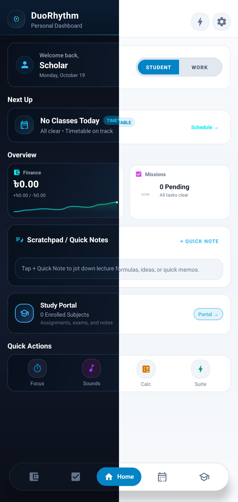
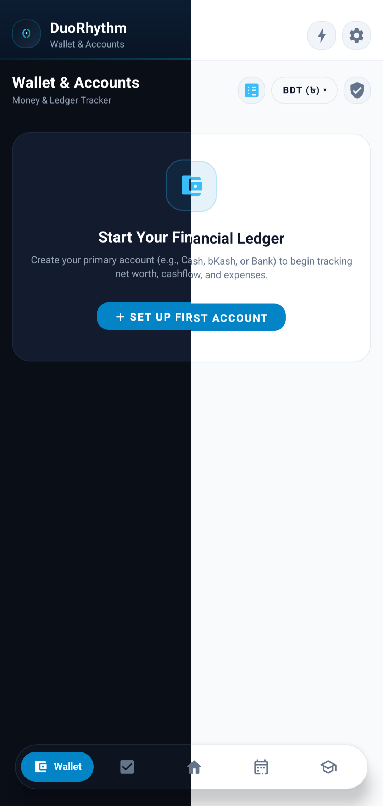
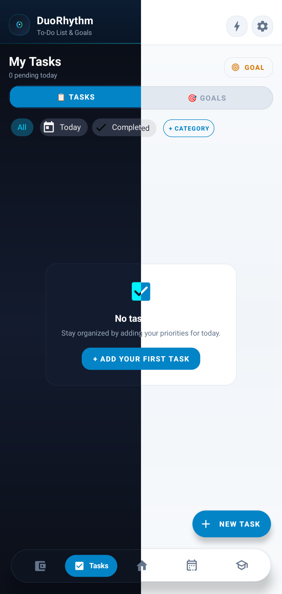
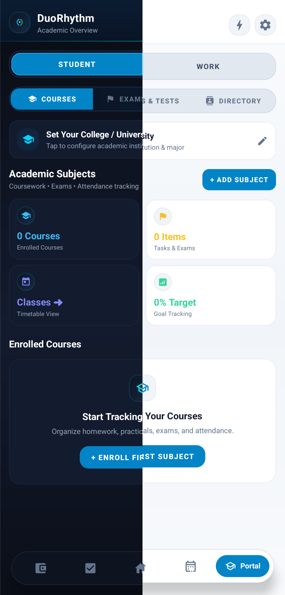
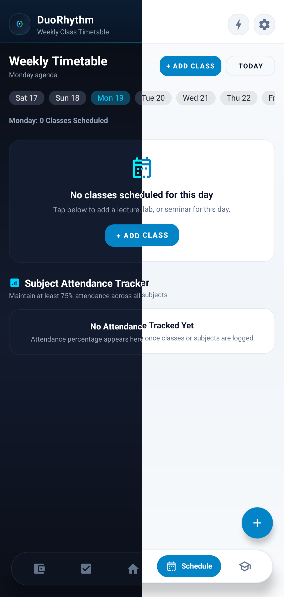
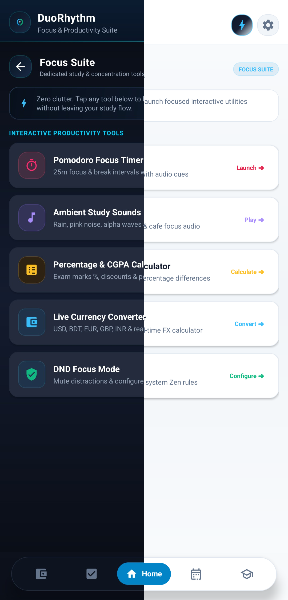

# DuoRhythm
**Next-Gen Local-First Financial Ledger & Academic Companion**

An offline, zero-telemetry Android suite built for students and independent builders who need strict capital accounting alongside coursework engineering.

[**Download DuoRhythm APK**](https://github.com/MI-Musanna/DuoRhythm/releases/latest) • [**Issue Tracker**](https://github.com/MI-Musanna/DuoRhythm/issues)

---

## 📱 Interface Walkthrough

| Home & Quick Brief | Wallet & Multi-Bucket | Task & Goal |
| :---: | :---: | :---: |
|  |  |  |

| Academic Portal | Weekly Routine | Focus Suite |
| :---: | :---: | :---: |
|  |  |  |

---

## ⚙️ Core Architecture & Capabilities

### 💼 Smart Financial Ledger
- **Multi-Account Buckets:** Isolate liquid cash into up to 5 dedicated wallets (Physical Cash, Bank, Mobile Financial Services) with independent running balances.
- **Atomic Balance Transfers:** Inter-account fund shifting with double-entry integrity—eliminating discrepancies between sending and receiving ledgers.
- **Adaptive Visual Analytics:** Live Donut breakdown for category expenditures alongside dual-column bar charts comparing total inflows against outflows.
- **Bilateral Dues & Debt Tracker:** Clean ledger separating receivables ("They Owe") and liabilities ("You Owe") with one-tap partial or full settlement stamping.
- **Direct Currency Parity:** Native 1:1 BDT (৳) recordkeeping without forced international conversion clutter.

### 🎓 Academic Command Center
- **Coursework Management:** Maintain subject codes, credit hours, classroom locations, and faculty profiles in one unified card system.
- **Dynamic Weekly Timetable:** Intelligent 7-day class routine highlighting active lectures with 12-hour MaterialTimePicker schedule editing.
- **Attendance Threshold Engine:** Real-time attendance percentage calculator with early-warning alerts for institutional minimums (e.g. 75% target).
- **Assessment Pipeline:** Track Semester Finals, Midterms, Class Tests, and Quizzes with deadline countdowns and status toggles.
- **Multi-Format Document Vault:** Batch file importer for lecture PDFs, whiteboard captures, and notes with dynamic badges (`PDF`, `IMG`, `DOC`) and category filter chips.

### 🎯 Intentional Tasks & Milestone Goals
- **Decoupled Task Engine:** Hard separation between fleeting daily checklists and long-term milestones to prevent priority overload.
- **0–100% Milestone Tracking:** Granular progress control for multi-week projects with visual stage indicators.
- **Material 3 Calendar Dialogs:** Native MaterialDatePicker integration supporting optional deadlines and dynamic Start/End date ranges.

### 💼 Work Portal & Fast Directory
- **Client Job Board:** Track freelance jobs, technical specifications, and invoicing status without leaving your student dashboard.
- **1-Tap Communications:** Speed directory supporting instant cellular calls, direct WhatsApp messaging, and verified community channel routing.

### 🛡️ Privacy & Performance Standards
- **100% Offline-First:** Powered entirely by SQLite/Room DB. All data stays encrypted on your local hardware.
- **Zero Telemetry:** No analytics SDKs, no network pings, zero third-party data collection.
- **Calibrated Dual Theme Engine:** Handcrafted Deep Obsidian Dark Mode (`#0A0E17` to `#131D2F`) alongside an adaptive, high-contrast Light Mode with crisp white surfaces and visible dialog typography.

### 👤 3-Profile Workspace Isolation
- **Multi-Identity Architecture:** Maintain up to 3 completely isolated workspace profiles (Slot 1, Slot 2, Slot 3) on the same device.
- **Independent Databases:** Separate timetables, tasks, milestone goals, attendance records, wallets, and subscriptions for each profile.
- **Secure Switching:** Password hash authentication (`SHA-256`) with "Remember this email on this profile" support and instant toolbar switching.

### 🚀 First-Run Setup & In-App Updates
- **5-Step Onboarding Wizard:** First-launch interactive setup covering feature highlights, permission grants, primary profile creation, and quick launch.
- **GitHub Release Checker:** Built-in update detector querying official GitHub releases with full release notes display and direct APK download link.

---

## 📜 Changelog

### [v1.0.1-beta] - 2026-10-25
- **3-Profile System:** Added multi-slot profile isolation across tasks, goals, timetables, attendance, and wallets with password hash authentication.
- **5-Step Onboarding Wizard:** Implemented interactive first-launch setup with permission manager and profile 1 initialization.
- **GitHub Release Checker:** Integrated automated and manual update checking using GitHub REST API and OkHttp.
- **Toolbar & Settings Integration:** Added quick profile switcher to main navigation header and dedicated workspace management in settings.
- **Database & Architecture:** Upgraded SQLite/Room schema to Version 8 with seamless backward compatibility.

---

## 📥 Installation

1. Grab the latest package from [Releases](https://github.com/MI-Musanna/DuoRhythm/releases/latest).
2. Install `DuoRhythm-v1.0.1-beta.apk` on Android 8.0 (API 26) or higher.
3. Grant storage permissions for document attachment management if prompted.

---

## 📄 License
Released under the [MIT License](LICENSE).
